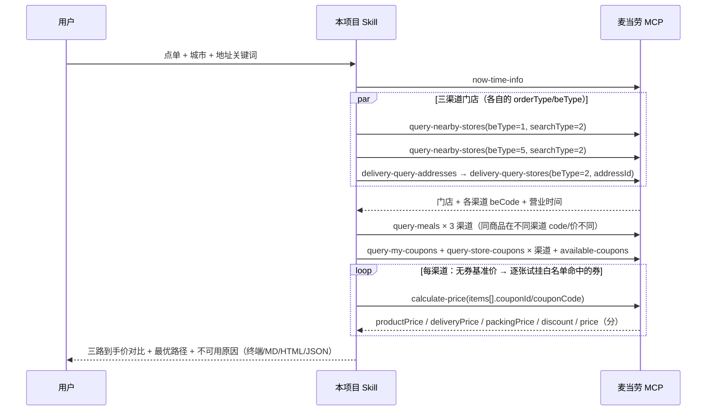

# MCP_INTEGRATION · 麦当劳 MCP 集成说明

本文件说明「麦麦三路比价侦探」**实际**使用的麦当劳 MCP Server / Tool、调用流程与业务价值。
只列代码里真实发起的调用；未使用的能力一律标注「未使用」，不虚构集成深度。
文中的 schema 字段、错误码与价格数字均来自本项目对一个真实 MCP Token 的实测，不是照文档推测。

## 1. 接入的 MCP Server

| 项 | 值 |
|---|---|
| 服务名称 | 麦当劳 MCP 服务（McDonald's China MCP Server） |
| 官方文档 | <https://github.com/M-China/mcd-mcp-server> · <https://open.mcd.cn/mcp/doc> |
| 接入地址 | `https://mcp.mcd.cn`（可用环境变量 `MCD_MCP_URL` 覆盖） |
| 传输协议 | Streamable HTTP，`Accept: application/json, text/event-stream` |
| 协议版本 | `2025-06-18`（本项目固定协商该版本） |
| 鉴权 | 请求头 `Authorization: Bearer <MCP Token>`，Token 只从环境变量 `MCD_MCP_TOKEN` 读取 |
| 线上工具数 | **35 个**（`tools/list` 实测，官方 README 文档为 33 个，线上已多出 `query-promotions`、`query-survey-coupon`） |
| 限流 | 单 Token 600 次/分钟，超限 `429` |
| 客户端实现 | `src/mcd_three_path/client.py`，纯标准库自实现，不依赖第三方 MCP SDK |

### 实现层面的四个对接细节（实测得出）

1. **业务失败不等于调用失败**。服务端大量情况下 HTTP 200、MCP 层也不报 `isError`，
   但返回体是 `{"success": false, "code": 508/60006/600012, "message": "..."}` 信封。
   本项目在 `envelope()` 统一判定，**把业务失败当成"这一路算不通"**，否则会把报错文案当成价格结论。
2. **无状态化**。部署不返回 `Mcp-Session-Id`，因此每次调用前重新 `initialize` + `notifications/initialized`。
3. **SSE 与 JSON 双形态解析**。响应可能是 `text/event-stream`，解析器同时支持两种。
4. **schema 自适应参数绑定**。`ToolCatalog` 启动时拉 `tools/list` 的 `inputSchema`，
   必填缺失在本地即抛出可读错误，不把 `null` 发给服务端。

## 2. 实际使用的 Tool（9 个）

| # | Tool | 实测必填参数 | 用途 | 调用位置 |
|:--:|---|---|---|---|
| 1 | `now-time-info` | 无 | 服务端时间 → 餐段判定 | `Comparator.server_now()` |
| 2 | `query-nearby-stores` | `beType`, `searchType` | 到店自取(`beType=1`) 与 得来速(`beType=5`) 门店；**得来速才返回 `beCode`** | `store_by_nearby()` |
| 3 | `delivery-query-addresses` | 无 | 取 `addressId`（外送链路的起点） | `store_by_delivery()` |
| 4 | `delivery-query-stores` | `beType=2`, `addressId` | 该地址可配送门店 + 外送渠道的 `beCode` | `store_by_delivery()` |
| 5 | `query-meals` | `storeCode`, `orderType`, `beType`（得来速/外送另需 `beCode`） | **各渠道各自**的菜单与售价 | `menu()` |
| 6 | `query-my-coupons` | 无 | 已持有券（含 `products` 商品白名单） | `coupons()` |
| 7 | `query-store-coupons` | `storeCode`, `orderType`, `beType`(+`beCode`) | 本店可用券 | `coupons()` |
| 8 | `available-coupons` | 无 | 可领未领数量，报告里只做提示 | `coupons()` |
| 9 | `calculate-price` | `storeCode`, `orderType`, `beType`, `items[]`(+`beCode`) | **核心**：逐渠道逐券官方实算 | `price()` |

### 三条决定了引擎形态的实测事实

1. **渠道由 `orderType` + `beType` 显式区分**，不是靠门店标签猜：
   到店自取 `1/1`、得来速 `1/5`、麦乐送 `2/2`（`6` 为企业团餐）。
2. **同一门店在不同渠道的 `beCode` 不同**。实测同一门店：得来速 `beCode = storeCode + "41"`，外送 `beCode = storeCode + "02"`，
   即 **beCode 是按渠道派生的编码**；到店自取**不传** `beCode`。
   缺 `beCode` 时服务端不报错，而是**静默返回空菜单**——本项目把它拦成可读的"该渠道菜单为空"。
3. **同一件商品在不同渠道的 `productCode` 与售价都不同**，所以三路对齐只能按**商品名**匹配，
   绝不能复用编码。实测（同一门店，2026-10-24 23:07）：

   | 商品 | 到店/得来速 | 麦乐送 |
   |---|---|---|
   | 巨无霸 | `1100` ¥26.5 | `901100` ¥29.0 |
   | 麦辣鸡翅 | `1700` ¥15.0 | `901700`（"麦辣鸡翅2块"）¥16.0 |
   | 薯条 | `4810` ¥14.0 | `501205`（"中薯条"）¥15.0 |
   | 可乐 | `9900008751` ¥9.5 | `903050`（"可口可乐"）¥11.0 |

   菜单项数量也不同：到店/得来速 109 项，外送 115 项。

### 金额口径（实测）

- `query-meals` 的 `currentPrice` 是**「元」字符串**（`"26.5"`）；
- `calculate-price` 的返回**全部是「分」整数**，且语义为：
  `price = productPrice(优惠后商品价) + deliveryPrice + packingPrice`，`originalPrice` 是优惠前合计。
- 实测外送比到店多的成本不止配送费：**打包服务费**是独立字段。本项目对每条 `calculate-price`
  都做加总一致性校验，对不上就在报告里写明"金额口径校验：…"，不静默采信。
- **券挂在具体商品上**：`items[].couponId` + `couponCode`（实测必须成对，且只挂到白名单命中的第一件商品，
  全挂会被拒）。`query-my-coupons` 用 `id`/`code`，`query-store-coupons` 用 `couponId`/`couponCode`，
  本项目在 `to_coupons()` 做别名归一。

### 未使用的工具（本项目刻意不调）

`auto-bind-coupons`（领券）、`create-order` / `party-order-create` / `mall-create-order`（下单）、
`cancel-order`、`draw-lottery`（消耗积分）、`delivery-create-address`（写地址）等有副作用的工具；
以及 `list-nutrition-foods`、`campaign-calendar`、`query-my-account`、`mall-*`、`query-party-*`、
`query-promotions`、`query-survey-coupon` 等与"渠道到手价"无关的查询工具。

理由：比价是一件**只读**的事。任何会改变账户状态（领走券、扣积分、生成订单）的操作，
都不应该由一个"看看哪条路便宜"的工具顺手做掉。

## 3. 调用流程



一次典型比价的请求量：门店 3–4 次、菜单 3 次、券 3–6 次、
算价 `渠道数 × (1 + 试挂券数)`（默认最多 8 张），实测约 **20–30 次**，
远低于 600 次/分钟；客户端另内置最小调用间隔与 `429` 指数退避。

## 4. 真实实测结果（本项目的验收依据）

对真实 Token 执行 `compare --city 江门 --keyword 台山 --items "巨无霸 + 麦辣鸡翅 + 2份薯条 + 可乐"`
（广东江门市区某商圈，三条渠道命中的是同一家门店），服务端时间 **2026-10-24 23:07**：

| 渠道 | 到手价 | 商品金额 | 配送费 | 打包服务费 | 优惠 | 结论 |
|---|---:|---:|---:|---:|---:|---|
| 到店自取 | **¥79.00** | ¥79.00 | — | — | ¥0 | 最优 |
| 麦乐送 | ¥95.00 | ¥86.00 | ¥6.00 | ¥3.00 | ¥0.50 | 最贵 |
| 得来速 | 不可用 | — | — | — | — | 该渠道菜单为空：当前时刻不在可点时段内，营业时间 07:00-23:00 |

- 结论：**同一份餐点外送比到店自取贵 ¥16.00（16.8%）**，且贵出来的部分里
  有 ¥9.00 是纯渠道成本（配送 ¥6 + 打包 ¥3），另有 ¥7.00 是同名商品在外送渠道本身定价更高。
- 该账号有 **3 张券可领未领**；已持有券在两条渠道共试挂 8 次，全部被
  `600012`（"促销规则不支持该商品" / "当前优惠券不可用！"）拒绝，
  即"有券"与"这单能用"是两件事 —— 这正是必须逐渠道实算而不能靠推测的原因。
- 过程中还实测到误导性文案：拿外送渠道的 `productCode` 去算到店价，服务端返回
  `code 508 "太火爆了，请稍后再试"`，与真实原因（渠道商品码不匹配）完全无关；
  不可售则返回 `60006 "商品已售罄或不可售，换一个商品或检查orderType/beType"`。

> 仓库自带的 `fixtures/demo-cassette.json` 是**结构与线上完全一致、内容全部虚构**的演示数据
> （门店/商品/券编码均为合成，`meta.source = "demo"`），用途是让没有 Token 的人也能离线跑通链路；
> 其中所有价格都不是麦当劳官方实时价格。上面这张表来自真实调用。

## 5. 业务价值

- **回答一个每天都发生但没有现成答案的问题**：同一份餐，到底去店里拿还是点外送更划算。
  跨入口人工比价要在三个渠道分别加购、分别试算，本项目一条命令出三路官方实算价。
- **把"渠道成本"拆到可视**：商品价差、配送费、打包服务费、券的真实可用性四件事分别列出，
  用户能看到"贵在哪一项"，而不是只看到一个总数。
- **不可用原因是结构化的一等公民**：不在营业时段、无配送门店、券白名单不含本单、
  商品码跨渠道不匹配——这些正是人工比价中途放弃的地方，说清楚才有信任价值。
- **零副作用**：全程只读查询与价格试算，不领券、不下单、不扣积分，可以放心挂进任何 Agent。
- **可复用的对接层**：`client.py` + `tools.py` 与"比价"业务解耦，
  官方新增渠道或字段漂移时可低成本扩展，也是这套 schema 自适应写法的价值所在。

## 6. 如何自行复核真实链路

```bash
export MCD_MCP_TOKEN=你的Token          # 只走环境变量，不写进任何文件
python -m mcd_three_path probe --schema query-nearby-stores,query-meals,calculate-price
python -m mcd_three_path compare --city 江门 --keyword 台山 \
  --items "巨无霸 + 2份薯条" --trace --json /tmp/real.json
```

`probe` 打印服务端真实 `inputSchema`，`--trace` 打印本项目发起的每一次 MCP 调用、参数与成败，
两者结合即可复核「本项目确实真实使用了麦当劳 MCP 能力」这一硬性条件。
注意 `--trace` 输出包含你自己的门店与券信息，分享前请自行删除。
