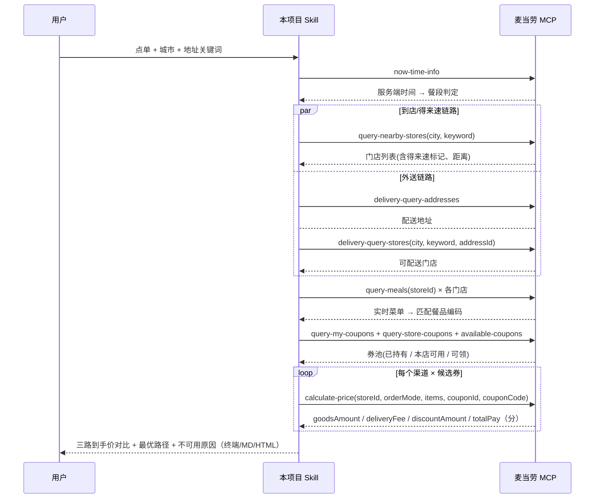

# MCP_INTEGRATION · 麦当劳 MCP 集成说明

本文件说明「麦麦三路比价侦探」**实际**使用了哪些麦当劳 MCP Server / Tool、调用流程与业务价值。
只列真实被代码调用的工具，未调用的能力一律标注为「未使用」，不虚构集成深度。

## 1. 接入的 MCP Server

| 项 | 值 |
|---|---|
| 服务名称 | 麦当劳 MCP 服务（McDonald's China MCP Server） |
| 官方文档 | <https://github.com/M-China/mcd-mcp-server> · <https://open.mcd.cn/mcp/doc> |
| 接入地址 | `https://mcp.mcd.cn`（可用环境变量 `MCD_MCP_URL` 覆盖） |
| 传输协议 | Streamable HTTP（`Content-Type: application/json`，`Accept: application/json, text/event-stream`） |
| 协议版本 | `2025-06-18`（官方声明支持该版本及更早版本，本项目固定协商此版本） |
| 鉴权方式 | 请求头 `Authorization: Bearer <MCP Token>`，Token 只从环境变量 `MCD_MCP_TOKEN` 读取 |
| 限流 | 单 Token 600 次/分钟，超限返回 `429` |
| 客户端实现 | `src/mcd_three_path/client.py`（纯标准库自实现，不依赖第三方 MCP SDK） |

### 实现层面的三个对接细节

1. **无状态化**：部分部署不返回 `Mcp-Session-Id`。客户端策略是「拿到 session 就复用，
   拿不到就每次调用前重新 `initialize` + `notifications/initialized`」，两种形态都能跑通。
2. **SSE 兼容**：响应 `Content-Type` 可能是 `application/json`，也可能是 `text/event-stream`；
   解析器同时支持两种（含 `data:` 多行拼接与 `[DONE]`）。
3. **schema 自适应参数绑定**：工具名稳定，字段名随版本（1.0.0 → 1.0.9）漂移。
   `ToolCatalog` 启动时拉一次 `tools/list`，把领域语义参数（`store_id` / `city` / `items` …）
   按别名表映射到 `inputSchema.properties` 里真实存在的字段；必填缺失时**在本地就报出可执行的错误**，
   而不是把 `null` 发给服务端。

## 2. 实际使用的 Tool（9 个）

| # | Tool | 用途 | 调用位置 |
|:--:|---|---|---|
| 1 | `now-time-info` | 校准服务端时间 → 判定当前餐段，避免推荐「此刻点不了」的方案 | `Comparator.server_now()` |
| 2 | `query-nearby-stores` | 到店自取 / 得来速的候选门店；从 `tags`、名称与服务字段中识别「得来速」能力 | `Comparator.nearby_stores()` |
| 3 | `delivery-query-addresses` | 取用户可配送地址，作为外送链路的起点 | `Comparator.delivery_stores()` |
| 4 | `delivery-query-stores` | 该地址可配送的门店（常与到店门店不同） | `Comparator.delivery_stores()` |
| 5 | `query-meals` | 门店实时菜单 → 把口语点单解析成官方餐品编码与单点价 | `Comparator.menu()` / `resolve()` |
| 6 | `query-my-coupons` | 已持有券，进入用券候选池 | `Comparator.coupons()` |
| 7 | `query-store-coupons` | 本店可用券（渠道/门店限定） | `Comparator.coupons()` |
| 8 | `available-coupons` | 统计当前可领券数量，报告里提示「还有 N 张可领未领」 | `Comparator.coupons()` |
| 9 | `calculate-price` | **核心**：逐渠道实算商品金额 / 配送费 / 优惠 / 应付总额（单位：分） | `Comparator.price()` |

### 未使用的工具（本项目刻意不调）

`auto-bind-coupons`（领券）、`create-order` / `party-order-create` / `mall-create-order`（下单）、
`cancel-order`（取消订单）、`draw-lottery`（消耗积分抽奖）、`delivery-create-address`（写地址）
等**有副作用**的能力，全部返回 `query-order` / `order-list` / `mall-*` 等与题无关的查询工具也均未调用。

理由：比价是一件**只读**的事。任何会改变用户账户状态（领走券、扣积分、生成订单）的操作
都不应该由一个「看看哪条路便宜」的工具顺手做掉。项目里保留了对服务端工具清单的动态探测，
即使官方后续新增渠道相关只读工具，也可以直接纳入比价而不引入写操作。

## 3. 调用流程



一次典型比价的请求量：门店与菜单 5–7 次，券 3 次，
算价 `渠道数 × (1 + 试挂券数)`（默认最多 6 张，即上限约 21 次），
总计约 **30 次请求**，远低于 600 次/分钟的限流；
客户端另内置最小调用间隔与 `429` 指数退避。

## 4. 实测踩到的坑与对策

| 现象 | 结论 | 代码里的处理 |
|---|---|---|
| 算价返回 `11450` | **金额单位是分**，不是元 | 全程整数「分」运算，仅在展示层换算；`--money-unit` 可强制口径 |
| 挂券报 `600010` | `couponId` 与 `couponCode` 必须**成对** | 发请求前校验 `Coupon.pair`，不成对直接跳过并记录，不浪费一次请求 |
| 成对后仍报 `600012` | 券有时段 / 门店 / SKU 白名单等隐性条件 | 逐渠道逐券实算，失败回退到无券价并写明原因；**保留可用渠道的结论** |
| `query-nearby-stores` 返回空 | `city` 与 `keyword` **必须同传**，schema 看不出该联动约束 | `REQUIRED_HINTS` 本地强校验，缺参数直接抛可读错误 |
| 门店是否支持得来速无固定字段 | 能力散落在 `tags` / 名称 / 服务标记里 | 关键词兜底识别（得来速 / drive / MDS / 汽车餐厅 / 免下车），识别不到就标「不可用」而不是猜 |
| 响应没有 `Mcp-Session-Id` | 会话不可依赖 | 无状态策略：每次调用前重新 `initialize` |
| 响应是 `text/event-stream` | 不是纯 JSON | 双形态解析器 |
| 服务端字段命名漂移 | 同一工具在不同版本字段名不同 | `pick()` / `_get()` 做多候选键提取，配合 `tools/list` 别名映射 |

## 5. 业务价值

- **把跨入口的人工比价变成一次查询**：三个渠道分别加购试算，人工至少 6–9 步；本 Skill 一条命令。
- **决策依据来自官方实算**，不是「据说外送更贵」：每一路的价格都能追溯到一次 `calculate-price` 调用与返回。
- **不可用原因结构化**：券在得来速不参与、附近无得来速门店、菜单无此品——这些正是用户放弃比价的原因，被明确说出来才有信任价值。
- **零副作用**：只读查询 + 价格试算，不领券不下单，可放心接入任何 Agent。
- **可复用**：客户端与 schema 自适应层与「比价」解耦，官方新增只读工具或新渠道场景码时可低成本扩展。

## 6. 如何自行验证真实链路

```bash
export MCD_MCP_TOKEN=你的Token          # 只走环境变量
python -m mcd_three_path probe --schema now-time-info,query-nearby-stores,calculate-price
python -m mcd_three_path compare --city 上海 --keyword 南京西路 \
  --items "巨无霸 + 2份中薯条" --trace --json real.json
```

`probe` 会打印服务端真实 `inputSchema`，`--trace` 会输出本项目发起的全部 MCP 调用与参数，
两者结合即可复核「本项目确实调用了麦当劳 MCP」这一参赛硬性条件。
仓库内的 `fixtures/demo-cassette.json` 是**演示数据**（`meta.source = "demo"`），
仅用于让没有 Token 的评审离线复现交互形态，不作为任何价格结论来源。
