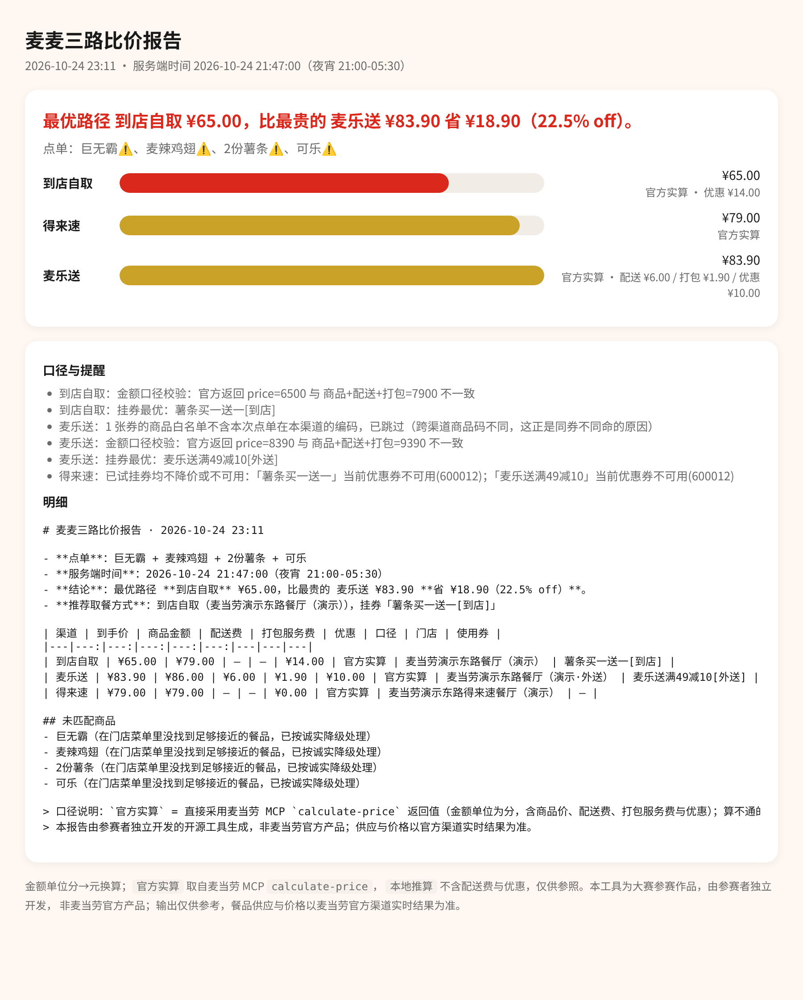

# 麦麦三路比价侦探 · MCD Three-Path Detective

> 同一份麦当劳点单，**到店自取 / 麦乐送 / 得来速** 三条路各自的**真实到手价**是多少？
> 别再靠感觉选渠道了——这个项目直接调麦当劳官方 MCP，逐路实算、择优推荐，并生成一页可视化报告。

麦当劳程序员创意开发大赛（2026 1024 程序员节）参赛作品 · 参赛者独立开发，**非麦当劳官方产品**。



---

## 它解决什么问题

想吃的东西已经定了，但**在哪买**是个每天都在发生的决策：

- 到店自取：省配送费，但券能不能用？
- 麦乐送：券看着大，加完配送费还划算吗？
- 得来速：方便，可很多活动券根本不参与。

人工比价要跨三个入口分别加购、分别试算，还容易漏掉「这张券在得不可用」。
本项目把这件事压缩成一条命令：**输出一份点单，拿到三条路的官方实算到手价与最优路径。**

核心设计原则是**诚实降级**：任何一路算不通（门店无得来速能力、券不可用、菜单没这个品）
都会带上真实原因写进报告，**绝不用估算价冒充官方实算价**，也绝不猜价格。

## 功能特性

| 能力 | 说明 | 依赖的麦当劳 MCP 工具 |
|---|---|---|
| 口语点单解析 | 「巨无霸 + 2份中薯条 + 可乐(中)」直接喂进来，自动匹配门店菜单编码 | `query-meals` |
| 三渠道门店定位 | 到店/得来速用附近门店，外送用可配送地址所属门店 | `query-nearby-stores`、`delivery-query-addresses`、`delivery-query-stores` |
| 券的真实可用性 | 已持有券 + 本店可用券一起进候选池，逐张实算取最优 | `query-my-coupons`、`query-store-coupons`、`available-coupons` |
| **官方逐路实算** | 每个渠道分别调官方算价，拆开商品价 / 配送费 / 打包服务费 / 优惠，金额单位「分」精确换算 | `calculate-price` |
| 时段校准 | 用服务端时间判断当前餐段，避免算出「此刻点不了」的方案 | `now-time-info` |
| 三种报告形态 | 终端表格 / Markdown / 单页 HTML（可直接分享） | — |
| 离线回放 | 结构对齐线上真实 schema 的录制文件，让没 Token 的人也能三行命令跑通全链路 | — |
| 金额口径自检 | 每次实算都校验 `price = 商品 + 配送 + 打包`，对不上就在报告里标注 | — |
| 凭证零落地 | Token 只走环境变量；仓库内置敏感信息自检测试 + CI | — |

## 安装

```bash
git clone https://github.com/<你的用户名>/mcd-three-path-detective.git
cd mcd-three-path-detective
python3 -m venv .venv && source .venv/bin/activate   # 可选
pip install -r requirements.txt                       # 运行本体零依赖，装的是 pytest
```

只依赖 Python 3.9+ 标准库（MCP 客户端为自实现 Streamable HTTP，无需额外包）。

### 配置麦当劳 MCP

1. 到 <https://open.mcd.cn/mcp> 用手机号登录 → 控制台 → 点击「激活」申请 **MCP Token**（免费）。
2. 把 Token 放进环境变量，**不要写进任何文件**：

   ```bash
   export MCD_MCP_TOKEN=你的Token
   ```

3. 想接到 Cursor / Cherry Studio / TRAE / WorkBuddy 等 MCP 客户端，照抄
   [`mcp-config.example.json`](mcp-config.example.json) 并替换占位符即可。

## 使用

### ① 先自检连通性与工具是否齐备

```bash
python -m mcd_three_path probe
```

输出会逐个核对比价链路依赖的 9 个工具是否存在，并回显服务端时间。

### ② 跑一次三路比价（真实模式）

```bash
python -m mcd_three_path compare \
  --city 上海 --keyword 南京西路 \
  --items "巨无霸 + 麦辣鸡翅2块 + 2份中薯条 + 可乐(中)" \
  --html report.html --markdown report.md --json report.json --trace
```

终端输出长这样（下面这段来自仓库自带的**演示**录制，`meta.source = "demo"`，
所有编码与价格均为虚构，**不是麦当劳官方实时价格**）：

```text
渠道             到手价        商品       附加费      优惠  口径 / 门店 / 备注
到店自取        ¥65.00    ¥79.00         —  ¥14.00  官方实算｜…｜薯条买一送一[到店]
麦乐送         ¥83.90    ¥86.00配送¥6.00+打包¥1.90  ¥10.00  官方实算｜…｜麦乐送满49减10[外送]
得来速         ¥79.00    ¥79.00         —   ¥0.00  官方实算｜…

最优路径 **到店自取** ¥65.00，比最贵的 麦乐送 ¥83.90 **省 ¥18.90（22.5% off）**。
```

配好自己的 Token 跑同一条命令，得到的是**真实**结果。下面是本项目对真实 Token 实测的一次输出
（2026-10-24 23:07，广东江门市区某商圈，三路命中的是同一家门店）：

| 渠道 | 到手价 | 商品金额 | 配送费 | 打包服务费 | 优惠 | 结论 |
|---|---:|---:|---:|---:|---:|---|
| 到店自取 | **¥79.00** | ¥79.00 | — | — | ¥0 | 最优 |
| 麦乐送 | ¥95.00 | ¥86.00 | ¥6.00 | ¥3.00 | ¥0.50 | 最贵 |
| 得来速 | 不可用 | — | — | — | — | 当前时刻不在该渠道可点时段（营业时间 07:00-23:00） |

同一份餐外送比到店自取贵 **¥16.00（16.8%）**，其中 ¥9.00 是纯渠道成本（配送+打包），
¥7.00 是同名商品在外送渠道本身定价更高。当时该账号还有 3 张券可领未领，
已持有券试挂 8 次全部被 `600012` 拒绝——"有券"和"这单能用"确实是两件事。

### ③ 没有 Token 也能立刻看产物（离线回放）

```bash
python -m mcd_three_path --replay fixtures/demo-cassette.json compare \
  --city 上海 --keyword 南京西路 --items "巨无霸 + 中薯条" --html demo/report.html
```

### ④ 录制你自己的真实响应，方便复现与提 Issue

```bash
python -m mcd_three_path compare --city 深圳 --keyword 科苑南路 \
  --items "板烧鸡腿堡" --record my-cassette.json
```

录制内容自动脱敏，可安全提交（也可只留在本地）。

### 常用参数

| 参数 | 作用 |
|---|---|
| `--channels in,del,dt` | 只比其中几路（到店 / 外送 / 得来速） |
| `--store <id或名称片段>` | 锁定某家门店，避免自动选到不想要的店 |
| `--money-unit auto\|cents\|yuan` | 金额口径兜底：官方算价返回整数即「分」 |
| `--max-coupon-probes 6` | 最多逐张试挂几张券（控制请求量，官方限流 600 次/分钟） |
| `--trace` | 打印完整 MCP 调用轨迹，排查「为什么这路不可用」 |

## 目标用户

- **每天在「到店拿还是点外送」之间犹豫的人**：一句话拿到三条路的实算到手价。
- **手里攒了一堆券的人**：直接告诉你哪张券在当前渠道真的能减钱。
- **做外卖/到店价格研究、自动化点单的人**：可以把它当 Skill 挂进任意 MCP 客户端复用。
- **开发者**：`src/mcd_three_path/` 是一套可直接搬走的「Streamable HTTP MCP 客户端 +
  schema 自适应参数绑定 + 诚实降级」参考实现。

## 作为 Skill 使用

仓库里的 [`SKILL.md`](SKILL.md) 描述了触发条件、工具编排与输出契约，
把它放进支持 MCP 的客户端（WorkBuddy / Cursor / TRAE / Cherry Studio）即可让 Agent 直接调用本项目，
不需要你自己敲命令行。

## 工程要点（全部来自实测，不是照文档抄的）

详见 [`MCP_INTEGRATION.md`](MCP_INTEGRATION.md)。这几条决定了两路以上比价能不能算对：

1. **渠道靠 `orderType` + `beType` 显式区分**：到店 `1/1`、得来速 `1/5`、麦乐送 `2/2`，
   不是靠门店标签猜出来的。
2. **`beCode` 按渠道派生**：同一门店的得来速与外送 `beCode` 不同；缺了它服务端**不报错，
   只静默返回空菜单**。本项目把这种"静默空结果"拦成可读的不可用原因。
3. **同一件商品在不同渠道的 `productCode` 和售价都不一样**（实测：巨无霸到店 `1100` ¥26.5、
   外送 `901100` ¥29.0；可乐到店 `9900008751` ¥9.5、外送"可口可乐" `903050` ¥11.0）。
   所以三路只能**按商品名对齐**，复用编码必然算错——这是本项目存在的理由。
4. **金额有两套口径**：菜单 `currentPrice` 是"元"字符串，`calculate-price` 返回全是"分"整数，
   且 `price = productPrice(券后) + deliveryPrice + packingPrice`。每次算价都做加总校验。
5. **券挂在具体商品上**，`items[].couponId/couponCode` 必须成对，且要挂到白名单命中的那件商品；
   券自带的 `products` 白名单跨渠道就失效了。
6. **业务失败不体现在 HTTP 层**：`{"success": false, "code": 508/60006/600012}` 一样是 200 返回。
   其中 `508` 的文案是"太火爆了，请稍后再试"，真实原因却是商品码不属于该渠道——
   不看 `success` 字段就会把报错当成一个便宜的价格。
7. **限流 600 次/分钟** + **服务端不返回 session-id**：内置最小调用间隔、`429` 指数退避、
   每次调用前重新 `initialize`。

## 测试与 CI

```bash
PYTHONPATH=src pytest -q          # 全离线，无需 Token，24 条测试
```

CI（GitHub Actions）跑离线测试 + 敏感信息扫描，**不需要任何 Token**，
任何人都可以 fork 后直接改直接验证。

## 安全与合规

- Token 只从环境变量 `MCD_MCP_TOKEN` 读取，日志与报错一律脱敏，绝不写入文件、绝不出现在报告里。
- 本项目**只做只读查询与价格试算**：不会领券、不会下单、不会兑换积分。
  （`auto-bind-coupons`、`create-order`、`mall-create-order`、`draw-lottery` 等有副作用的工具未被调用。）
- 输出仅供参考，不构成营养、医疗或消费建议；餐品信息、价格与供应状态以麦当劳官方渠道实时结果为准。
- 详见 [`CONTEST_DECLARATION.md`](CONTEST_DECLARATION.md)（大赛官方参赛声明，原文未改动）。

## 与同类作品的差异

大赛示例是「点餐助手 / 省钱助手 / 活动推荐助手」，排行榜里价格方向已经相当拥挤。
本项目切的是**渠道维度**：同一份餐、同一时刻、三种取餐方式的**平行实算对比**——
这是麦当劳 MCP 同时开放到店、麦乐送、得来速三套门店与算价能力后才变得可行的题，
`query-nearby-stores` / `delivery-query-stores` / `calculate-price` 的 `orderMode`
组合几乎没被当作主要矛盾使用过。

## License

MIT（见 [`LICENSE`](LICENSE)）。示例配置、参数与代码可按仓库声明用于连接与使用麦当劳 MCP 服务。

## 致谢

- 麦当劳中国 MCP 服务（<https://open.mcd.cn/mcp>，Server 地址 `https://mcp.mcd.cn`）
- 麦当劳程序员创意开发大赛组委会
